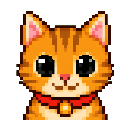

<div align="center">
  

  # Catsumi

  **A playful pixel-art cat that lives on your Windows desktop.**

  [](https://www.microsoft.com/windows)
  [](https://flutter.dev/)
  
</div>

Catsumi wanders around the desktop, performs different activities, reacts to the kind of application you are using, and moves into an animated notification-area icon when the full pet should stay out of the way.

## Features

- Animated pixel-art cat with 16 activities and moods
- Draggable, resizable, transparent desktop pet
- Animated notification-area icon beside Wi-Fi and volume
- One cat at a time: the desktop pet and tray cat do not appear together
- Reactions for coding, browsing, music, meetings, inactivity, and more
- Automatic hiding while a fullscreen application is active
- Multi-monitor and Windows work-area awareness
- Pause, hide, click-through, startup, and size controls
- Single-instance protection and persistent settings
- Local-only activity detection with no keystroke or document recording

## How Catsumi behaves

| Situation | Catsumi's response |
| --- | --- |
| Desktop is available | Appears as the full animated pet and explores the work area |
| Coding or typing | Uses the keyboard animation |
| Browsing or reading | Uses the reading animation |
| Music application is active | Listens with headphones |
| Meeting application is active | Sits quietly near the taskbar |
| User is idle | Becomes tired or sleeps |
| Fullscreen application is active | Hides the desktop pet |
| Pet is hidden | Continues as one animated tray icon |

Catsumi also chooses occasional idle activities such as walking, running, eating, drinking coffee, dancing, climbing, tracking the cursor, and yawning.

## Controls

| Action | Result |
| --- | --- |
| Drag the desktop cat | Move it anywhere inside the current monitor's work area |
| Double-click the cat | Trigger a reaction |
| Right-click the cat | Open the Catsumi controls |
| Left-click the tray cat | Summon the full pet for five minutes |
| Right-click the tray cat | Open the controls from the notification area |
| Increase / Decrease size | Resize the desktop cat between 96 and 288 units |
| Reset size | Restore the default size of 168 units |

After you drag Catsumi, autonomous walking pauses for five minutes so the cat stays where you placed it. If **Click-through** is enabled, use the tray cat's right-click menu to disable it again.

## Requirements

- Windows 10 or Windows 11, 64-bit
- [Flutter](https://docs.flutter.dev/get-started/install/windows/desktop) with Windows desktop support
- Visual Studio with the **Desktop development with C++** workload and a Windows SDK

The project currently targets Flutter 3.44 or newer and Dart 3.12 or newer.

## Run locally

Clone the repository using GitHub's **Code** button, then run:

```powershell
cd Catsumi
flutter doctor
flutter pub get
flutter run -d windows
```

## Build a Windows release

```powershell
flutter test
flutter analyze
flutter build windows --release
```

The packaged application is created at:

```text
build\windows\x64\runner\Release\
```

Distribute the entire `Release` directory. The executable depends on the DLLs and Flutter data stored beside it, so copying only `catsumi.exe` will not work.

## Privacy

Catsumi uses Windows APIs to inspect only broad local state needed for its behavior:

- the foreground executable name and basic window metadata;
- the time since the last keyboard or mouse input;
- fullscreen, monitor, taskbar, and work-area state.

Catsumi does **not** read typed text, key contents, clipboard data, documents, browser URLs, or file contents. Activity classification and animation selection happen locally.

## Settings

User preferences are saved to:

```text
%APPDATA%\Catsumi\settings.json
```

This includes pet size, pause state, click-through state, startup preference, and other persistent controls.

## Animations

The current animation set includes:

```text
idle           walk             run              sleep
eat            read             type             dance
track cursor   climb            fall             taskbar sit
drink coffee   listen to music  confused         tired / yawn
```

The transparent sprite atlases are stored in `Assets/Animations`, with brand and animated tray artwork in `Assets/Brand`.

## Project structure

```text
Catsumi/
├── Assets/
│   ├── Animations/       # Pixel-art sprite atlases and animation metadata
│   └── Brand/            # App icon and tray animation frames
├── lib/
│   ├── models/           # Animation and settings models
│   ├── services/         # Behavior, environment, settings, startup, and Win32 bridge
│   └── widgets/          # Pet renderer and controls
├── test/                 # Flutter tests
└── windows/runner/       # Native Windows host, tray icon, window handling, and resources
```

## Troubleshooting

**The cat cannot be clicked**  
Right-click the tray cat and turn off **Click-through**.

**The tray cat is missing**  
Open the Windows taskbar settings and allow Catsumi under **Other system tray icons**, or drag it out of the tray overflow panel.

**An old second cat icon is pinned to the taskbar**  
Unpin the older Catsumi launcher. The current app uses a single animated notification-area icon while the desktop pet is hidden.

**The pet started moving again after I positioned it**  
Dragging temporarily pauses autonomous movement. Normal behavior resumes after five minutes; use **Pause animations** when you want Catsumi to remain still for longer.

## Contributing

Bug reports, animation ideas, and pull requests are welcome. Please run `flutter test` and `flutter analyze` before submitting code changes.

---

<div align="center">
  Made for people who want a tiny animated companion while they work.
</div>
